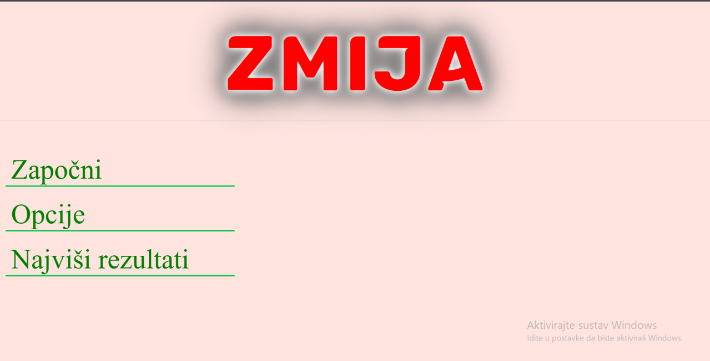
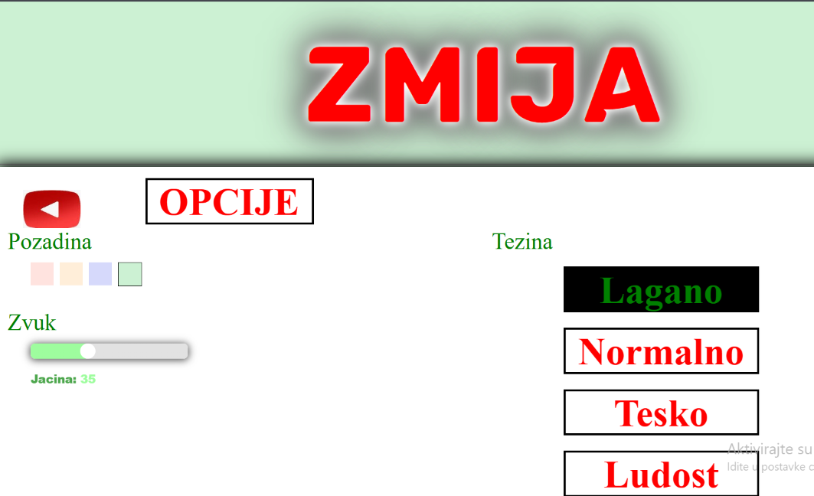
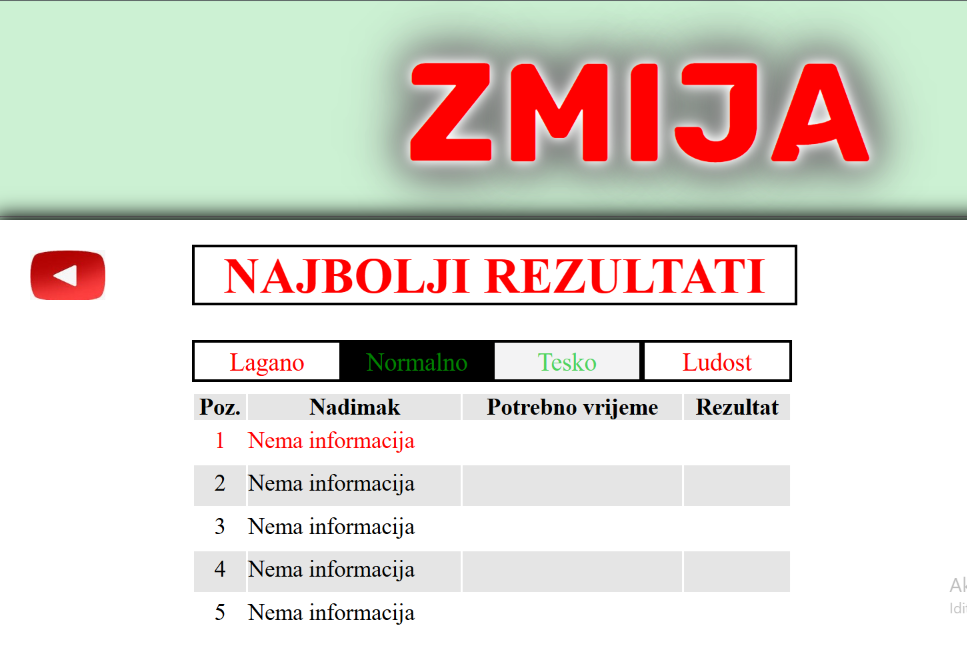
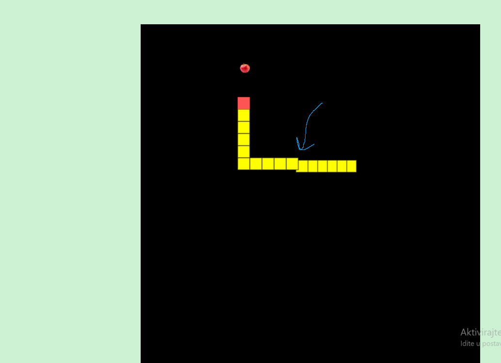
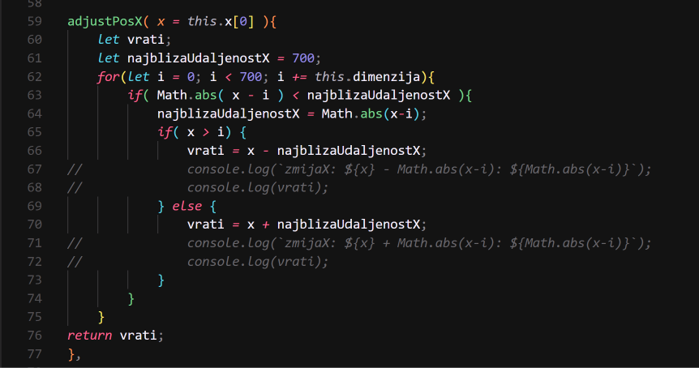
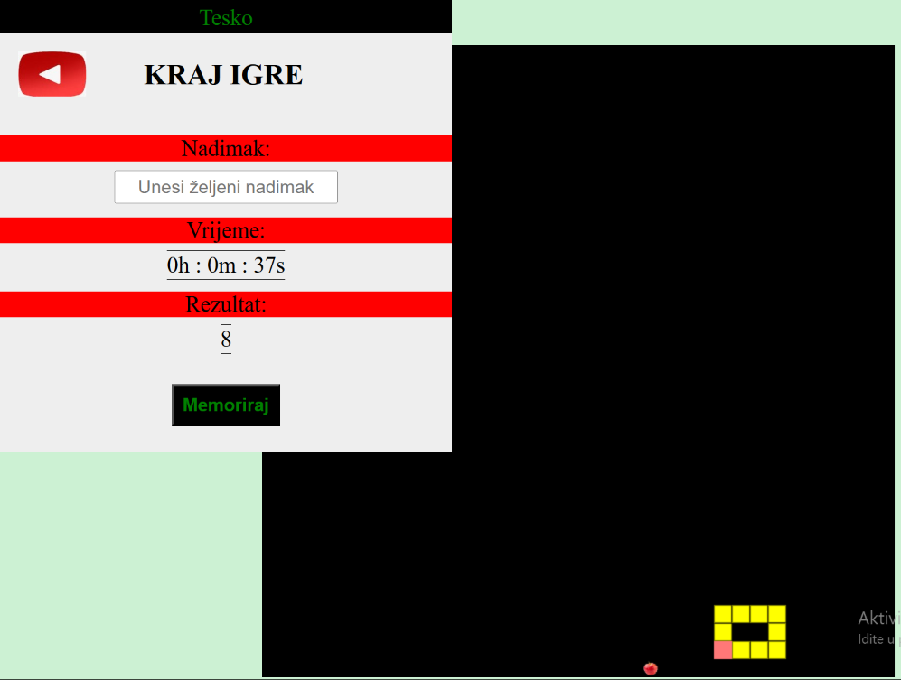

# Zavrsni rad - Zmija
## Video igrica (ona igrica sa starih mobitela sa fizickim tipkama)

### O programu:
Za zavrsni rad za kraj srednje skole dobio sam napraviti igricu zmiju. Koncept je vrlo jednostavan. Zmija se sastoji od bloka glave i blokova tijela. Zmija se moze kretati po mapi (gore, dolje, lijevo, desno) zavisno od naseg inputa (upravlja se sa strelicama). Cilj igrice je pojesti sto vise jabuka koje se "random" spawnaju na mapi. Smatra se da je hrana pojedena kada blok glave zmije dode na istu lokaciju kao hrana. Zmija tada naraste za 1 blok. Igra zavrsava kada se zmija ugrize za rep (blok glave se nalazi na istoj poziciji kao i jedan od blokova tijela) ili kada zmija izade iz granica mape. 
Uz to dodatno sam napravio razlicite tezine igranja (na svakoj razini zmija je brza od prethodne), main menu, opcije: mijenjanje pozadine, mogucnost spremanja bodova u tablicu rezultata i u Local Storage tako da se sve postavke i rezultati spreme za sljedece pokretanje igre, i rast dimenzija blokova zmije. Ovu znacajku sam izveo tako sto samo usporedio prijasnju poziciju bloka zmije i novu velicinu grida mape kako bih znao koliko trebam offsetat pojedini blok zmije.

### Demonstracija:

#### Slika prikazuje main menu igrice

#### Slika prikazuje postavke igrice

#### Slika prikazuje tablicu rezultata

#### Sljedece slike prikazuje izvedbu rasta blokova zmije

#### Slika prikazuje kada se ostvari game over uvjet

### Instalacija:
* Step 1: Kloniraj projekt
* Step 2: Gotovo
* Pokrenuti ces igricu tako sto ces otvoriti datoteku "Zmija.html"